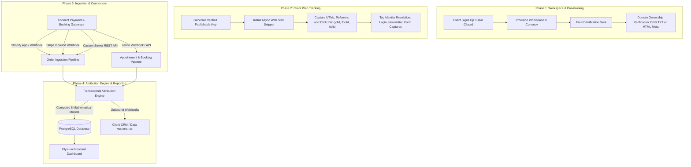

# Elysium Attribution Platform — Client Service Delivery & Onboarding Playbook

> **Audience:** Internal Account Executives, Implementation Engineers, and Client Stakeholders (CMOs, Growth Marketers, Developers).  
> **Purpose:** Standard operating procedure (SOP) for provisioning, onboarding, integrating, and delivering attribution services to clients.

---

## 1. Executive Summary & Value Proposition

Traditional analytics platforms (Google Analytics 4, Meta Pixel) rely on third-party cookies and client-side pixels that are heavily degraded by **Apple iOS 14.5+ App Tracking Transparency (ATT)**, Safari **Intelligent Tracking Prevention (ITP)**, and browser ad-blockers. Consequently, ad platforms over-report conversions by 30–50% through duplicated attribution claims, while Google Analytics under-reports conversion paths.

**Elysium** provides a first-party, server-side verified multi-touch attribution platform that:
- Captures first-party touchpoints across the entire customer lifecycle.
- Unifies anonymous device visitors into verified customer profiles using cryptographic identity resolution (SHA-256).
- Attributes revenue and bookings deterministically across **6 distinct attribution models**.
- Reconciles refunds and cancellations in real time so marketing spend is evaluated only against settled revenue.

---

## 2. End-to-End Service Delivery Workflow



---

## 3. Step-by-Step Client Onboarding Guide

### Step 1: Workspace Setup & Verification (Day 1)
1. **Workspace Creation:**
   - Client or Account Executive registers via `/api/auth/company/register`.
   - Configure Workspace settings:
     - **Reporting Currency:** e.g., `USD`, `EUR`, `GBP`, `INR`.
     - **Timezone:** Matching client operating headquarters (e.g., `America/New_York`).
     - **Attribution Lookback Window:** Default is `30` days (customizable up to `90` days for high-ticket services).
2. **Domain Ownership Verification:**
   - In **Settings → Sites**, add the primary store or booking domain (e.g., `winkbrowbar.com`).
   - Choose a verification method:
     - **DNS TXT Record:** Host `@` with value `attribution-verification=<token>`.
     - **HTML Meta Tag:** Add `<meta name="attribution-verification" content="<token>">` inside site `<head>`.
   - Verify via dashboard. Live publishable API keys (`pk_live_...`) remain protected until verified.

---

### Step 2: Website Tracking Snippet Installation (Day 1 - 2)

The Elysium Web SDK is lightweight (<12 KB), non-blocking, and loads asynchronously.

```html
<!-- Elysium Attribution Platform SDK -->
<script
  src="https://cdn.yourapp.com/attribution-sdk.js"
  data-api-key="pk_live_your_verified_publishable_key"
  async>
</script>
```

#### Integration via Google Tag Manager (GTM):
1. Open client's GTM Workspace.
2. Create a new Tag: **Custom HTML**.
3. Paste the snippet above.
4. Set Trigger to: **Initialization - All Pages** (or **All Pages**).
5. Publish container.

#### Integration via Shopify:
1. Go to **Online Store → Themes → Actions → Edit code**.
2. Open `layout/theme.liquid`.
3. Paste the snippet immediately before the closing `</head>` tag.
4. Save.

---

### Step 3: Identity Resolution Setup (Day 2)

To bridge anonymous browser visits with customer profiles, fire the `identify` call whenever a user enters their contact details:

```javascript
// Fire on newsletter submission, account login, or shipping address entry
if (window.attribution && window.attribution.identify) {
  window.attribution.identify({
    email: "customer@example.com",
    phone: "+15551234567"
  });
}
```

> [!NOTE]
> All email addresses and phone numbers are normalized (trimmed, lowercased) and cryptographically hashed with **SHA-256** prior to database insertion. Raw PII is never stored in plain text.

---

### Step 4: Connecting Ingestion Gateways (Day 2 - 3)

We connect the client's conversion source so incoming transactions match against tracked visitor journeys.

#### A. Shopify Stores
1. In Shopify Admin, navigate to **Settings → Notifications → Webhooks**.
2. Create Webhook:
   - **Event:** `Order creation`
   - **Format:** `JSON`
   - **URL:** `https://api.yourapp.com/api/connectors/shopify/webhook?connectorId=<connector_id>`
3. Paste the shared secret into Elysium **Settings → Connectors**.

#### B. Stripe Payments
1. Open Stripe Dashboard → **Developers → Webhooks**.
2. Add Endpoint:
   - **Endpoint URL:** `https://api.yourapp.com/api/connectors/stripe/webhook?connectorId=<connector_id>`
   - **Events to send:** `charge.succeeded`, `checkout.session.completed`, `charge.refunded`.
3. Copy the Signing Secret (`whsec_...`) into Elysium.

#### C. Zenoti (Salons, Spas & Medical Clinics)
1. In Zenoti Admin, configure outgoing webhooks for:
   - **Appointment Created / Rescheduled**
   - **Invoice Closed / Paid**
2. Target: `https://api.yourapp.com/api/connectors/zenoti/webhook?connectorId=<connector_id>`.

---

## 4. Understanding the Elysium Dashboard

The Elysium frontend displays real-time attribution data powered by the `GET /api/workspace/dashboard` API:

```
┌────────────────────────────────────────────────────────────────────────────────────────────────────────┐
│  Revenue by source:  [████████████████████████████████████████████████ Google 95% ][ Direct 2% ][ Meta 3% ]  │
└────────────────────────────────────────────────────────────────────────────────────────────────────────┘

┌─────────────────────────────────────────────────────────┐
│  $49,849.40                                             │  Company-wide revenue, all locations
│  $34,894.58 excl tax  ·  $14,954.82 tax                 │  combined, across 144 invoices.
└─────────────────────────────────────────────────────────┘

┌───────────────────────┬───────────────────────┬───────────────────────┬───────────────────────┐
│ New Customers         │ Returning Customers   │ Retention             │ Tracked Visits        │
│ 383                   │ 74                    │ 50.3%                 │ 2,406                 │
│ company-wide          │ company-wide          │ 1659 of 3297, all-time│ company-wide          │
├───────────────────────┼───────────────────────┼───────────────────────┼───────────────────────┤
│ Ad-Attributed Revenue │ Direct/Organic Revenue│ Unattributed Revenue  │ Refunded              │
│ $6,494.72             │ $46,221.31            │ $0.00                 │ $-127.32              │
│ Meta + Google + AWIN  │ walk-ins & untracked  │ no conversion at all  │ 3 refunds · all locs  │
└───────────────────────┴───────────────────────┴───────────────────────┴───────────────────────┘

┌───────────────────────┐
│ Avg Order Value       │
│ $64.65                │
│ ▼ 18.1% vs prior      │
└───────────────────────┘

┌────────────────────────────────────────────────────────────────────────────────────────────────────────┐
│  Revenue by Platform                                                   all locations · sent conversions │
│  PLATFORM                   CONVERSIONS                                                    REVENUE     │
│  [ Direct ]                 735                                                         $47,585.16     │
│  [ Google ]                 91                                                           $6,542.63     │
│  [ AWIN ]                   8                                                              $276.03     │
│  [ META ]                   7                                                              $296.03     │
└────────────────────────────────────────────────────────────────────────────────────────────────────────┘
```

### Key Metrics Defined:
- **Ad-Attributed Revenue:** Revenue mathematically verified to originate from paid ads (Google Ads, Meta Ads, AWIN affiliate links).
- **Direct / Organic Revenue:** Revenue from direct navigation, organic search, or offline walk-in bookings without ad intervention.
- **Retention Rate:** Total repeat purchasers divided by total historical customer base.
- **Tracked Visits:** Total touchpoints recorded across all web properties in the selected period.

---

## 5. Attribution Models Available for Clients

Clients can toggle between **6 attribution models** in their dashboard dropdown:

| Model | How it Credits | Ideal Use Case |
|---|---|---|
| **Last Non-Direct (Default)** | 100% to the last paid/campaign touchpoint before purchase. | Standard e-commerce baseline & paid media evaluation. |
| **First Touch** | 100% to the very first channel that discovered the user. | Top-of-funnel brand awareness & prospecting ad analysis. |
| **Last Touch** | 100% to the final touchpoint immediately before payment. | Short sales cycle flash sales & promotional SMS/email blasts. |
| **Linear** | Equal credit distributed across all touchpoints. | Understanding full-funnel collaborative touchpoint impact. |
| **Time Decay** | Exponential weighting (7-day half-life) giving more credit to recent touches. | Long consideration cycles (high-ticket services, luxury goods). |
| **Position-Based (U-Shaped)** | 40% to First Touch, 40% to Last Touch, 20% divided among middle touches. | Comprehensive multi-channel customer acquisition strategies. |

---

## 6. Client Onboarding Checklist

Use this checklist during kickoff calls with clients:

- [ ] **Contract & Plan Selected:** Starter, Growth, or Enterprise.
- [ ] **Account Provisioned:** Admin registered and invited via `/api/auth/company/register`.
- [ ] **Domain Verification:** DNS TXT or Meta tag verified in dashboard.
- [ ] **Tracking Snippet Installed:** Verified via browser network inspector (firing `POST /v1/touches`).
- [ ] **Identity Resolution Hooked:** Email/phone captured on signup forms or checkout (`POST /v1/identify`).
- [ ] **Cart / Session Freezing:** Checkout token created before redirecting to payment gateway.
- [ ] **Inbound Connectors Verified:** Test orders generated in Shopify / Stripe / Zenoti and verified in dashboard.
- [ ] **Outbound Webhooks Configured (Optional):** Destination CRM (Klaviyo, HubSpot, Snowflake) set up.
- [ ] **Team Training Completed:** Marketing team trained on switching attribution models and interpreting ROAS.
