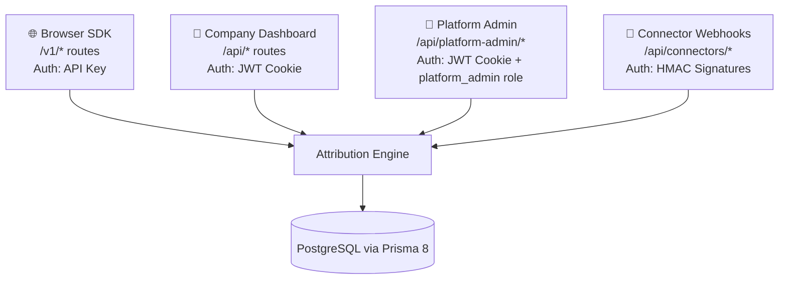
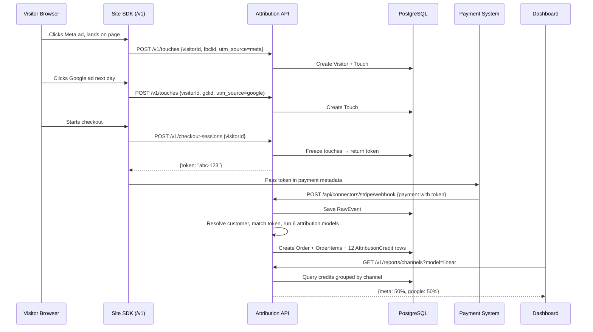

# Attribution System Backend — Complete Codebase Guide

---

## 1. The Big Picture

This is a **multi-tenant attribution platform** backend. It answers one question for every company:
> *"Which marketing channel brought this paying customer?"*

There are **3 separate worlds** in this codebase, each with its own auth mechanism:



---

## 2. Entry Point — How a Request Flows

Start here: [`server.js`](file:///c:/AttributionSystemBackend/server.js)

```
Request arrives
    │
    ├─ /v1/*              → v1Routes.js        → apiKeyAuth middleware     → controller
    ├─ /api/auth/*        → authRoutes.js       → (no auth, public)        → authController
    ├─ /api/api-keys/*    → apiKeyRoutes.js     → protectRoute middleware   → apiKeyController
    ├─ /api/sites/*       → siteRoutes.js       → protectRoute + role      → siteController
    ├─ /api/user/*        → userRoutes.js       → protectRoute             → userController
    ├─ /api/workspace/*   → workspaceRoutes.js  → protectRoute + role      → workspaceController
    ├─ /api/platform-admin/* → platformAdminRoutes.js → protectRoute + platform_admin → platformAdminController
    └─ /api/connectors/*  → connectorRoutes.js  → (signature verification) → connectorController
```

---

## 3. Recommended Reading Order

Read the codebase in this exact sequence. Each layer builds on the previous one.

### Layer 0: Config & Database

| # | File | What to understand |
|---|---|---|
| 1 | [`utils/env.js`](file:///c:/AttributionSystemBackend/utils/env.js) | All environment variables the app needs. Start here to know what external services are required (DB, JWT, Resend email, etc.) |
| 2 | [`.env.example`](file:///c:/AttributionSystemBackend/.env.example) | Template for the actual `.env` file |
| 3 | [`src/prisma/contract.prisma`](file:///c:/AttributionSystemBackend/src/prisma/contract.prisma) | **The most important file.** Every table, every column, every relationship. Read top-to-bottom. It's organized in 3 sections: Enums → Tenancy & Access → Company Setup → Core Attribution Engine |
| 4 | [`src/prisma/db.js`](file:///c:/AttributionSystemBackend/src/prisma/db.js) | How the Prisma 8 client is initialized. Every controller imports `db` from here. The ORM is used as `db.orm.public.ModelName` |
| 5 | [`prisma.config.ts`](file:///c:/AttributionSystemBackend/prisma.config.ts) | Prisma 8 configuration |

### Layer 1: Auth & Middleware

| # | File | What to understand |
|---|---|---|
| 6 | [`utils/genToken.js`](file:///c:/AttributionSystemBackend/utils/genToken.js) | JWT token creation. The payload contains `{ id, role, name, email, workspaceId }`. Token is set as an `httpOnly` cookie named `user_token` |
| 7 | [`middlewares/protectRoute.js`](file:///c:/AttributionSystemBackend/middlewares/protectRoute.js) | **Two exports:** `protectRoute` (reads JWT cookie → looks up user in DB → sets `req.user`) and `requireRole(...roles)` (checks `req.user.role`). Every dashboard route uses these |
| 8 | [`middlewares/apiKeyAuth.js`](file:///c:/AttributionSystemBackend/middlewares/apiKeyAuth.js) | **Two exports:** `v1Cors` (CORS for browser SDK) and `apiKeyAuth(allowedTypes)` (reads API key from `Authorization: Bearer` header → hashes → looks up → verifies origin/expiry → sets `req.workspaceId` and `req.apiKey`). Every `/v1` route uses this |

> [!IMPORTANT]
> **The critical design rule:** The workspace ID on `/v1` routes comes ONLY from the API key lookup, never from the request body. This is how tenant isolation is enforced for public API calls.

### Layer 2: Auth Flow (User Registration & Login)

| # | File | What to understand |
|---|---|---|
| 9 | [`routes/authRoutes.js`](file:///c:/AttributionSystemBackend/routes/authRoutes.js) | 6 routes: register, login, verify email, forgot password, get me, logout |
| 10 | [`controllers/authController.js`](file:///c:/AttributionSystemBackend/controllers/authController.js) | **`registerCompany`** — creates a Workspace + admin User in one transaction, sends verification email. **`companyLogin`** — bcrypt compare → set JWT cookie. **`verifyUser`** — token hash lookup → activates workspace. **`sendMe`** — decode cookie, return payload |
| 11 | [`services/emailServices.js`](file:///c:/AttributionSystemBackend/services/emailServices.js) | Thin wrapper around Resend API for sending transactional emails |
| 12 | [`templates/signupVerification.html`](file:///c:/AttributionSystemBackend/templates/signupVerification.html) | HTML email template with `{{name}}` and `{{verificationUrl}}` placeholders |

### Layer 3: Company Setup (Sites & API Keys)

| # | File | What to understand |
|---|---|---|
| 13 | [`routes/siteRoutes.js`](file:///c:/AttributionSystemBackend/routes/siteRoutes.js) | CRUD + domain verification routes |
| 14 | [`controllers/siteContoller.js`](file:///c:/AttributionSystemBackend/controllers/siteContoller.js) | **`addSite`** — normalizes domain, generates verification token, returns DNS/meta instructions. **`verifySite`** — checks DNS TXT records or fetches homepage for meta tag (with SSRF protection). Key concept: a site must be verified before its API keys work in live mode |
| 15 | [`routes/apiKeyRoutes.js`](file:///c:/AttributionSystemBackend/routes/apiKeyRoutes.js) | CRUD + rotate routes |
| 16 | [`controllers/apiKeyController.js`](file:///c:/AttributionSystemBackend/controllers/apiKeyController.js) | **One active key per workspace** rule. Key is SHA-256 hashed before storage — the plaintext is shown exactly once at creation. **`rotateApiKey`** — revokes old + creates new in one transaction (no gap). Includes origin validation and audit logging |

### Layer 4: The Core Attribution Pipeline ⭐

This is the heart of the product. Read these in order — they form a single pipeline:

| # | File | What to understand |
|---|---|---|
| 17 | [`controllers/trackingController.js`](file:///c:/AttributionSystemBackend/controllers/trackingController.js) | **Step 1: Collect.** `recordTouch` — SDK sends every page visit. Upserts Visitor, creates Touch with UTMs/click IDs, classifies channel. `identifyVisitor` — links visitor to customer by email/phone. `createCheckoutSession` — **freezes** the visitor's touches into a snapshot and returns a token |
| 18 | [`services/identityService.js`](file:///c:/AttributionSystemBackend/services/identityService.js) | **Step 2: Resolve.** `resolveOrCreateCustomer` — waterfall lookup: email hash → phone hash → external ID → create new. `linkVisitorToCustomer` — connects browser visitor to resolved customer. `hashIdentifier` — SHA-256 hash for PII |
| 19 | [`services/attributionEngine.js`](file:///c:/AttributionSystemBackend/services/attributionEngine.js) | **Step 3: Attribute.** `classifyChannel` — maps touch data to a channel name (using custom rules or UTM defaults). `filterTouches` — applies lookback window, suppresses direct touches when paid clicks exist. `computeShares` — calculates fractional credit for all 6 models. `buildCreditRows` — produces ready-to-insert AttributionCredit records |
| 20 | [`controllers/orderController.js`](file:///c:/AttributionSystemBackend/controllers/orderController.js) | **Step 4: Ingest Order.** `createOrder` ties it all together in one transaction: identity resolution → touch matching (token → email → visitor fallback) → lookback filter → new/returning check → build credit rows for all 6 models → save order + items + credits + audit log + consume checkout session |
| 21 | [`controllers/bookingController.js`](file:///c:/AttributionSystemBackend/controllers/bookingController.js) | Same pipeline as orders, but for bookings. Key difference: bookings are attributed at *creation* time, not payment time. Includes status lifecycle (scheduled → confirmed → completed/cancelled/no-show) |
| 22 | [`controllers/refundController.js`](file:///c:/AttributionSystemBackend/controllers/refundController.js) | Links refund to original order, updates `refundedMinorUnits`, flips status to `partially_refunded` or `refunded` |

> [!TIP]
> **The attribution waterfall** (how an order is matched to its marketing source):
> ```
> 1. Checkout token present? → Load frozen touches from CheckoutSession (confidence: token)
> 2. Email/phone present? → Find customer → Find their visitors → Load touches (confidence: email/phone)
> 3. Visitor ID present? → Load visitor's touches directly (confidence: click_id)
> 4. Nothing matched → Order is "Direct / unknown" (confidence: none)
> ```

### Layer 5: Connector Webhooks (Inbound Integrations)

| # | File | What to understand |
|---|---|---|
| 23 | [`routes/connectorRoutes.js`](file:///c:/AttributionSystemBackend/routes/connectorRoutes.js) | 5 webhook endpoints. Stripe gets a special raw body parser for signature verification |
| 24 | [`controllers/connectorController.js`](file:///c:/AttributionSystemBackend/controllers/connectorController.js) | Each handler: verify signature → save raw payload to `RawEvent` (before any processing) → normalize to canonical format → delegate to `createOrder`/`createBooking`/`createRefund`. If processing fails, the raw event is marked `failed` and can be replayed later |

> [!NOTE]
> Connectors use "fake req/res" objects to delegate to the order/booking controllers. This means the same attribution pipeline runs whether data comes from the SDK, a connector webhook, or the direct API.

### Layer 6: Reports & Customer Journeys

| # | File | What to understand |
|---|---|---|
| 25 | [`controllers/reportsController.js`](file:///c:/AttributionSystemBackend/controllers/reportsController.js) | 6 report endpoints: `summary` (revenue, orders, coverage), `channels` (by attribution model), `campaigns`, `locations`, `trend` (daily), `customers` (new/returning/repeat). All respect date range, model, and location filters |
| 26 | [`controllers/customerController.js`](file:///c:/AttributionSystemBackend/controllers/customerController.js) | `listCustomers` — paginated, excludes merged. `getCustomerJourney` — the full timeline: all touches → orders with credits → bookings with credits → refunds, under the selected attribution model |

### Layer 7: Workspace Management (Company Admin Dashboard)

| # | File | What to understand |
|---|---|---|
| 27 | [`routes/workspaceRoutes.js`](file:///c:/AttributionSystemBackend/routes/workspaceRoutes.js) | All workspace management routes in one place |
| 28 | [`controllers/workspaceController.js`](file:///c:/AttributionSystemBackend/controllers/workspaceController.js) | **Settings** — whitelist of editable fields. **Invites** — token-based invite flow with email. **Team** — list/update members. **Locations** — CRUD with timezone/currency per location. **Channel mapping rules** — priority-ordered rules that override default channel classification. **Webhooks** — outbound endpoint management with signing secret. **Audit log** — paginated view of all actions |
| 29 | [`controllers/connectorManagementController.js`](file:///c:/AttributionSystemBackend/controllers/connectorManagementController.js) | Company admin creates connectors, gets webhook URLs, views event feed, replays failed events |
| 30 | [`controllers/userController.js`](file:///c:/AttributionSystemBackend/controllers/userController.js) | Self-service update of company name, admin name, country, timezone, currency, industry |

### Layer 8: Platform Admin (Super Admin)

| # | File | What to understand |
|---|---|---|
| 31 | [`routes/platformAdminRoutes.js`](file:///c:/AttributionSystemBackend/routes/platformAdminRoutes.js) | All routes gated behind `platform_admin` role |
| 32 | [`controllers/platformAdminController.js`](file:///c:/AttributionSystemBackend/controllers/platformAdminController.js) | **Dashboard** — counts of workspaces/users/keys/connectors/webhooks. **Workspace management** — list, view details, change status (approve/suspend/close), update settings. **User management** — update role/status across any workspace. **API keys** — list all, revoke. **Connectors** — list all, change status. **Webhooks** — list all, update. Every action requires a `reason` parameter and writes an audit log entry |

---

## 4. Data Flow: From Ad Click to Dashboard



---

## 5. Key Patterns to Know

### Pattern: Tenant Isolation
Every DB query is scoped by `workspaceId`. The workspace ID comes from:
- **Dashboard routes:** `req.user.workspaceId` (from JWT, set by `protectRoute`)
- **Public API routes:** `req.workspaceId` (from API key lookup, set by `apiKeyAuth`)
- **Connector webhooks:** looked up from the Connector record

### Pattern: Transactional Consistency
Critical operations use `db.transaction(async (tx) => { ... })`. The transaction client `tx` is passed through so all writes commit or rollback together. Examples:
- Order creation + items + attribution credits + audit log
- Site deletion + key revocation + audit log
- API key rotation (revoke old + create new)

### Pattern: Audit Logging
Nearly every mutation writes to the `AuditLog` table with: who (`actorType` + `actorUserId`), what (`action` + `targetType` + `targetId`), why (`reason` for admin actions), and context (`ip`, `userAgent`, `metadata`).

### Pattern: Amounts in Minor Units
All money is stored as `BigInt` in minor units (cents/paise). A $99.99 order = `9999n` minor units. This avoids floating-point errors. The `currency` field always accompanies the amount.

### Pattern: Raw-First for Webhooks
Every inbound webhook saves the raw payload to `RawEvent` *before* any processing. If processing fails, the event can be replayed later. Status lifecycle: `pending → processed` or `pending → failed → replaying → processed/dead`.

---

## 6. File Tree (Annotated)

```
AttributionSystemBackend/
├── server.js                          ← Entry point, mounts all routes
├── package.json                       ← Dependencies & scripts
├── .env                               ← Secrets (never commit)
│
├── src/prisma/
│   ├── contract.prisma                ← DATABASE SCHEMA (read this first)
│   ├── contract.json                  ← Generated (don't edit)
│   ├── contract.d.ts                  ← Generated types (don't edit)
│   └── db.js                          ← Prisma client instance
│
├── middlewares/
│   ├── protectRoute.js                ← JWT auth + role guard
│   └── apiKeyAuth.js                  ← API key auth + CORS for /v1
│
├── utils/
│   ├── env.js                         ← Env var validation & export
│   ├── genToken.js                    ← JWT creation + cookie setting
│   ├── genSlug.js                     ← Company name → URL slug
│   └── genVisitor.js                  ← (legacy, unused)
│
├── services/
│   ├── attributionEngine.js           ← 6 attribution models + channel classification
│   ├── identityService.js             ← Customer resolution + visitor linking
│   └── emailServices.js               ← Resend email wrapper
│
├── controllers/
│   ├── authController.js              ← Register, login, verify, logout
│   ├── trackingController.js          ← Touches, identify, checkout sessions
│   ├── orderController.js             ← Order ingestion + full attribution pipeline
│   ├── bookingController.js           ← Booking ingestion + attribution
│   ├── refundController.js            ← Refund processing
│   ├── customerController.js          ← Customer list + journey view
│   ├── reportsController.js           ← 6 analytics report endpoints
│   ├── apiKeyController.js            ← API key CRUD + rotation
│   ├── siteContoller.js               ← Site CRUD + domain verification
│   ├── userController.js              ← Self-service profile update
│   ├── workspaceController.js         ← Settings, invites, locations, webhooks, audit
│   ├── connectorController.js         ← Inbound webhook handlers (Stripe/Shopify/etc.)
│   ├── connectorManagementController.js ← Connector CRUD + event replay
│   └── platformAdminController.js     ← Super admin operations
│
├── routes/
│   ├── authRoutes.js                  ← /api/auth/*
│   ├── v1Routes.js                    ← /v1/* (public API)
│   ├── apiKeyRoutes.js                ← /api/api-keys/*
│   ├── siteRoutes.js                  ← /api/sites/*
│   ├── userRoutes.js                  ← /api/user/*
│   ├── workspaceRoutes.js             ← /api/workspace/*
│   ├── connectorRoutes.js             ← /api/connectors/* (inbound webhooks)
│   └── platformAdminRoutes.js         ← /api/platform-admin/*
│
├── templates/
│   └── signupVerification.html        ← Email template
│
├── migrations/                        ← Prisma migration history
├── seedUsers.js                       ← Seed script for initial users
└── docker-compose.yaml                ← Local PostgreSQL
```

---

## 7. Quick Reference: "Where do I look for...?"

| I want to... | Look at |
|---|---|
| Understand the DB schema | [`contract.prisma`](file:///c:/AttributionSystemBackend/src/prisma/contract.prisma) |
| See how auth works | [`protectRoute.js`](file:///c:/AttributionSystemBackend/middlewares/protectRoute.js) → [`genToken.js`](file:///c:/AttributionSystemBackend/utils/genToken.js) |
| See how API keys work | [`apiKeyAuth.js`](file:///c:/AttributionSystemBackend/middlewares/apiKeyAuth.js) → [`apiKeyController.js`](file:///c:/AttributionSystemBackend/controllers/apiKeyController.js) |
| Understand the attribution logic | [`attributionEngine.js`](file:///c:/AttributionSystemBackend/services/attributionEngine.js) |
| See how orders get matched to sources | [`orderController.js`](file:///c:/AttributionSystemBackend/controllers/orderController.js) lines 80–120 (touch resolution waterfall) |
| See how identity resolution works | [`identityService.js`](file:///c:/AttributionSystemBackend/services/identityService.js) |
| See how webhooks from Stripe/Shopify arrive | [`connectorController.js`](file:///c:/AttributionSystemBackend/controllers/connectorController.js) |
| See all available API endpoints | [`server.js`](file:///c:/AttributionSystemBackend/server.js) → individual route files |
| See what the dashboard queries | [`reportsController.js`](file:///c:/AttributionSystemBackend/controllers/reportsController.js) |
| See how tenant isolation is enforced | Every controller — look for `workspaceId` in queries |
| See how domain verification works | [`siteContoller.js`](file:///c:/AttributionSystemBackend/controllers/siteContoller.js) `checkDns` and `checkMeta` functions |
| Add a new connector | Copy an existing handler in [`connectorController.js`](file:///c:/AttributionSystemBackend/controllers/connectorController.js), add route in [`connectorRoutes.js`](file:///c:/AttributionSystemBackend/routes/connectorRoutes.js), add type to the enum in `contract.prisma` |
